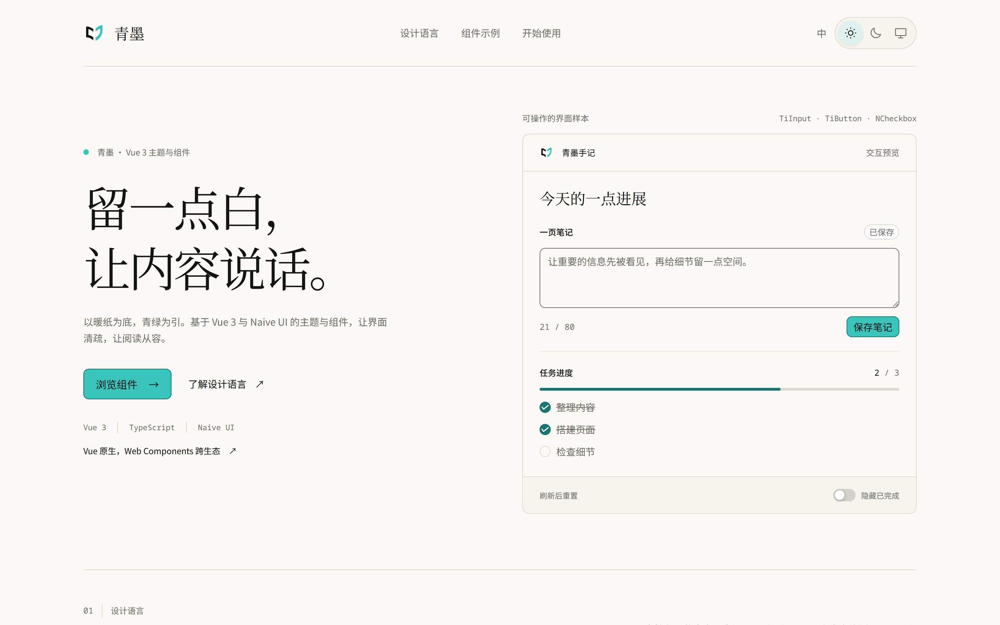
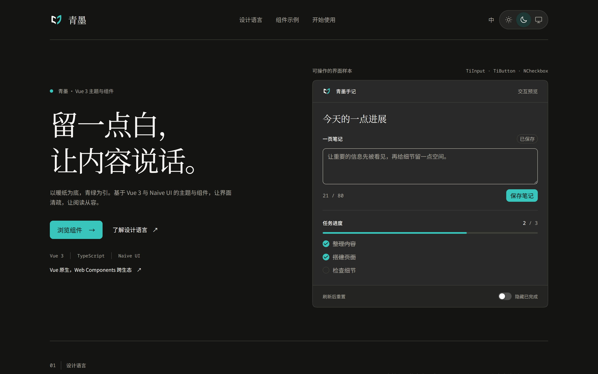

<div align="center">


**留一点白, 让内容说话**

基于 Vue 3 与 Naive UI 的主题与组件库, 并以 Web Components 接入 HTML 与其他框架

[在线预览](https://teal-ink.me0wo.cc/) · [设计规范](AGENTS.md) · [问题反馈](https://github.com/Sn0wo2/teal-ink-design/issues)



</div>

## 特性

- 一份 [`tokens.ts`](packages/teal-ink/src/tokens.ts) 输出 `--ti-*` CSS 变量, 明暗模式共享同一套语义
- 同一入口导出 Naive UI 全部组件与 `Ti*` 自有组件, 由 `TiProvider` 统一接管主题, 语言与全局样式
- 浅色, 深色与跟随系统三种模式, View Transitions 展开式主题切换, 尊重减少动态效果偏好
- [`@teal-ink/elements`](packages/elements) 提供 `ti-*` 标签, 复用同一套 Vue 组件与样式, 服务 HTML 与其他框架
- 展示站提供与导出一一对应的可操作示例, 源码见 [`examples/showcase`](examples/showcase)

## 安装

```sh
npm install @teal-ink/vue
```

Web Components 形态:

```sh
npm install @teal-ink/elements
```

## 快速上手

### Vue

```vue
<script setup lang="ts">
import { dateZhCN, TiButton, TiProvider, zhCN } from '@teal-ink/vue'
import '@teal-ink/vue/style.css'
</script>

<template>
  <TiProvider mode="system" :locale="zhCN" :date-locale="dateZhCN">
    <TiButton variant="primary">你好, 青墨</TiButton>
  </TiProvider>
</template>
```

`TiProvider` 默认浅色且只影响子树; `mode="system"` 跟随系统, `global` 同步文档根主题. 全部导出见 [入口文件](packages/teal-ink/src/index.ts)

### HTML 与其他框架

```html
<script type="module">
  import '@teal-ink/elements/register'
</script>

<ti-provider mode="system" locale="zh-CN">
  <ti-button variant="primary">你好, 青墨</ti-button>
</ti-provider>
```

`register` 会注册基础标签并加载组件样式, 无需另引 Vue 库的 CSS. 需要完整组合时改用 [`@teal-ink/elements/full`](packages/elements/src/full.ts), 通过 `ti-component` 宿主复用 Vue 的属性, 回调与插槽

## 文档

| 内容 | 位置 |
| ---- | ---- |
| 设计规范 | [AGENTS.md](AGENTS.md) |
| Vue 导出 | [packages/teal-ink/src/index.ts](packages/teal-ink/src/index.ts) |
| Naive UI 主题映射 | [packages/teal-ink/src/theme.ts](packages/teal-ink/src/theme.ts) |
| Web Components 入口 | [packages/elements/src/index.ts](packages/elements/src/index.ts) |

## 协议

[Apache-2.0](LICENSE)
