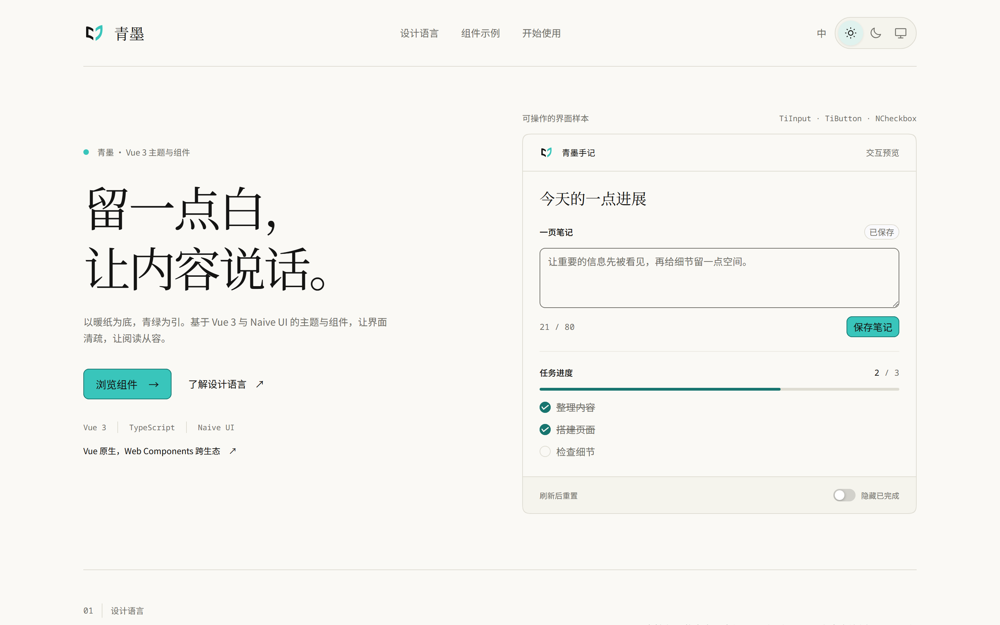
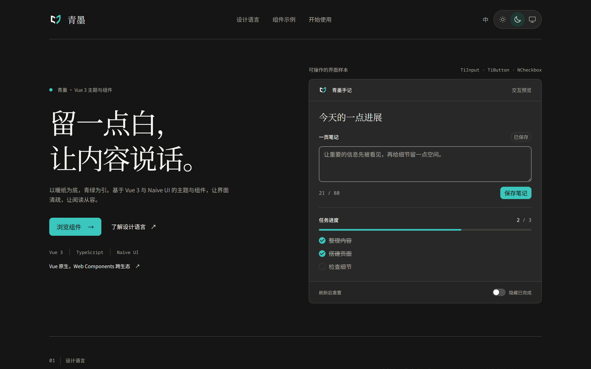

<div align="center">


[Live preview](https://teal-ink.me0wo.cc/) · [Design spec](AGENTS.md)



</div>

Teal Ink (青墨) is a design theme built on warm neutrals, with teal for primary actions and sage green for support. It ships as Vue components and Web Components sharing one token set.

## Install

```sh
npm install @teal-ink/vue
```

Web Components build:

```sh
npm install @teal-ink/elements
```

## Quick start

### Vue

```vue
<script setup lang="ts">
import { dateZhCN, TiButton, TiProvider, zhCN } from "@teal-ink/vue";
import "@teal-ink/vue/style.css";
</script>

<template>
  <TiProvider mode="system" :locale="zhCN" :date-locale="dateZhCN">
    <TiButton variant="primary">Hello, Teal Ink</TiButton>
  </TiProvider>
</template>
```

`TiProvider` defaults to light and only affects its subtree; `mode="system"` follows the system, `global` syncs the document root theme. See the [entry file](packages/teal-ink/src/index.ts) for all exports.

### HTML and other frameworks

```html
<script type="module">
  import "@teal-ink/elements/register";
</script>

<ti-provider mode="system" locale="zh-CN">
  <ti-button variant="primary">Hello, Teal Ink</ti-button>
</ti-provider>
```

`register` registers the base tags and loads component styles, so the Vue package's CSS is not needed. For the full component set, use [`@teal-ink/elements/full`](packages/elements/src/full.ts), which hosts Vue components through `ti-component` with props, callbacks, and slots.
